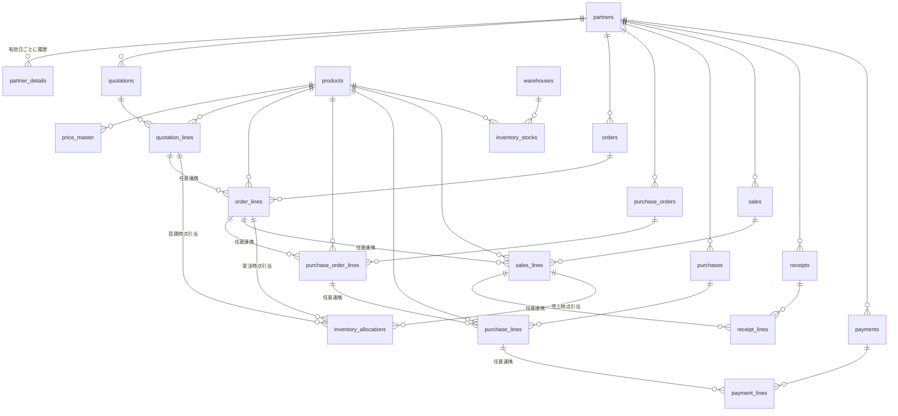

# DB設計（第1フェーズ）

対象範囲：共通マスタ／顧客管理（変更履歴・反映タイミング）／販売管理チェーン（見積〜支払）／在庫引当。
会計・人事給与・生産管理など未着手のモジュールは対象外（後続フェーズで別途設計）。

DDL本体は [`schema.sql`](./schema.sql) を参照。本ドキュメントは設計方針の説明。

---

## ER図（概要）

受注(`order_lines`)から発注(`purchase_order_lines`)と売上(`sales_lines`)の2方向に分岐する構造は、受注に対して仕入先手配（発注）と客先出荷（売上）が並行して発生する商流（見込在庫販売・仕入連動販売の両方）を想定している。

---

## 設計方針

### 1. 取引先マスタの「即時反映／日付指定反映」— SCD Type2パターン

`partners`（識別情報：不変）と `partner_details`（属性の時系列スナップショット）を分離した。

- 変更を登録する際は `partner_details` に **新しい行を追加**する（UPDATEで上書きしない）
- `effective_date` に登録日と同じ日付を入れれば「即時反映」、将来日付を入れれば「日付指定反映」になる
- 過去日付を指定して登録すれば、遡及訂正（先月の住所変更を今月気づいた、等）にも同じ仕組みで対応できる
- 「現在値」は `v_partner_current`（`effective_date <= CURRENT_DATE` の最新行）で取得する
- この行の積み重ね自体が**変更履歴ログ**になるため、別途ログテーブルを持つ必要がない
- 納品書・請求書などの帳票は、**帳票発行日（または対象取引の伝票日付）を基準日として** `partner_details` を検索し、その時点で有効だった住所・会社名を印字する（帳票側は「印字時点のスナップショット」を別途保持するのが望ましい。過去に発行済みの帳票が、後からの遡及訂正で内容が変わってしまうのを防ぐため）

「手入力の特記事項」は `partner_details.remarks` に保持し、取引履歴（見積/受注/発注/売上/仕入/入金/支払への参照）とは明確に区別する。取引履歴自体は非正規化して保存せず、`partner_id` で各伝票テーブルを検索して動的に一覧化する（顧客管理APIの `GET /partners/{id}/transactions` が担う）。

### 2. 伝票チェーンの連携と残数管理

見積→受注→発注→仕入→売上→入金／支払のすべてで共通のパターンを採用：

- 下位の明細テーブルに、上位明細への **nullable な外部キー**を1本持たせる（例：`order_lines.quotation_line_id`）
- NULL＝「上位伝票を経由しない直接入力」
- 残数（残高）は保存せず、**都度SUMして算出**する（`v_quotation_remaining` 等のビュー）。理由：
  - 明細の追加・取消のたびに残数カラムを更新するトリガーを持つと、更新漏れによる不整合リスクがある
  - 見積10個→受注7個→見積残3個、見積10個→受注13個→見積残0個、といった「超過時は残0」の丸めもビュー側の `GREATEST(x, 0)` で一元的に表現できる
- データ量が増えて集計コストが問題になった段階で、マテリアライズドビューや集計カラム＋トリガーへの切り替えを検討する（現時点では正規化を優先）

入金・支払は数量ではなく金額ベースなので、`amount` の差分で同じロジックを適用している（`v_sales_remaining_for_receipt`, `v_purchase_remaining_for_payment`）。

### 3. 見積の承認ワークフロー

`quotations.approval_status`（draft / pending / approved / rejected）で状態を管理し、PDF生成時にアプリケーション層で分岐する。

- `draft` / `pending` → PDFに「仮」の文字を印字
- `approved` → 社印（角印）画像を埋め込んだ正式なPDFを生成
- `approved_by` / `approved_at` で承認者・承認日時を記録

### 4. 在庫引当の3段階独立管理

`inventory_allocations` に `allocation_stage`（quotation / order / sales）を持たせ、CHECK制約で「そのステージに対応する明細IDのみ設定されている」ことを強制する。3ステージを1テーブルにまとめているのは、在庫可用数を計算する際に3種類の引当を横断的に集計する必要があるため（テーブルを分けると集計時のUNIONが増える）。

発注に対する入庫予定在庫は、別テーブルを持たず `v_purchase_order_remaining`（発注残＝入庫予定）で算出する。

### 5. あえて含めていないもの（後続フェーズ）

- 認証・権限（ロール、部門別アクセス制御）の詳細スキーマ — `users` は最小限のみ
- 会計仕訳との連携（売上計上・仕入計上時の自動仕訳生成）
- 消費税・端数処理ルール
- 帳票発行履歴（PDF生成物の保存・再発行管理）
- 監査ログ（全テーブル共通の操作履歴）— 現状は `created_by`/`created_at` のみ

---

## 命名規則

- テーブル名：複数形スネークケース（例：`purchase_orders`）
- 主キー：`id`（BIGSERIAL）。業務上の伝票番号は別カラム（例：`quotation_no`）としてUNIQUE制約を付与
- 外部キー：`{参照先単数形}_id`（例：`partner_id`）。上位明細への連携キーは `{上位テーブル単数形}_id`（例：`quotation_line_id`）
- 日時：作成・更新は `created_at` / `updated_at`（TIMESTAMPTZ）、業務日付は `_date`（DATE）
